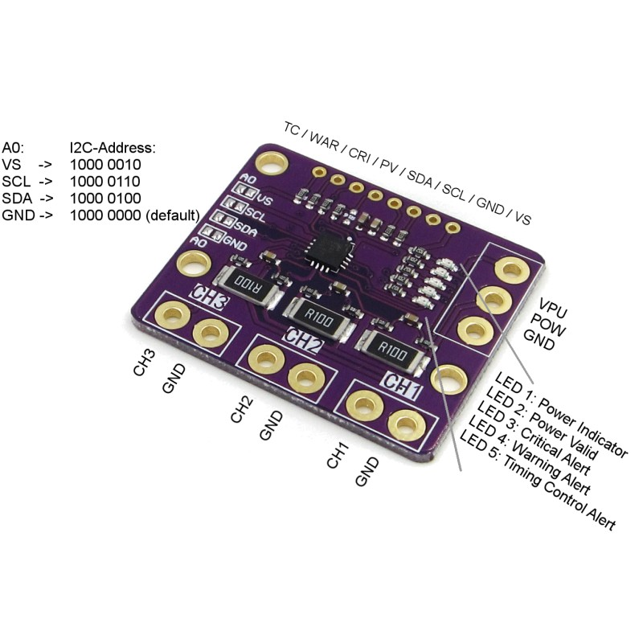

# INA3221 – miernik mocy

**INA3221** to układ Texas Instruments, który mierzy trzy linie zasilania naraz. Dla każdej linii odczytuje napięcie
oraz – przez mały rezystor bocznikowy (shunt) – prąd. Gdy prąd przekroczy ustawiony próg, wystawia alarm na swoich pinach.

*Zdjęcie przedstawia przykładową płytkę. Twoja może mieć inne opisy i części; układ jest ten sam.*

## Jak układ mierzy

- **Napięcie na boczniku:** każdy kanał mierzy spadek napięcia na swoim boczniku, krok **40 µV**, pełna skala **±163,84 mV**.
- **Napięcie szyny:** każdy kanał mierzy napięcie linii, krok **8 mV**, od **0 do 26 V**.
- **Prądu układ nie podaje.** Nie ma rejestru prądu. Aplikacja liczy go z napięcia na boczniku:
  **I = V(bocznik) / R(bocznik)**, a moc to **P = V(szyna) × I**.

Zakres i rozdzielczość zależą więc od rezystora R w linii:

| Bocznik R | Pełna skala na kanał (±) | Jeden krok prądu |
|---|---|---|
| 0,1 Ω (100 mΩ) | 1,638 A | 0,4 mA |
| 0,01 Ω (10 mΩ) | 16,38 A | 4 mA |

Pełna skala to 0,16384 V / R, jeden krok to 0,00004 V / R. Prąd powyżej pełnej skali nie daje większej liczby: odczyt
zatrzymuje się na górnej granicy.

## Podłączenie

- **Zasilanie:** układ zasilany jest z **VS** i **GND**.
- **Każdy kanał** włącz szeregowo z odbiornikiem: bocznik leży w linii, między zasilaniem a odbiornikiem.
- **Bocznik odwrócony:** odwrotnie podłączony bocznik daje prąd **ujemny**. Zaznacz jego kanał jako odwrócony w aplikacji,
  zamiast przelutowywać.

## Adres I2C

Pin **A0** wybiera adres. Połącz A0 z jednym z czterech pinów:

| A0 połączony z | Adres (7-bitowy) |
|---|---|
| GND | 0x40 (domyślny na większości płytek) |
| VS | 0x41 |
| SDA | 0x42 |
| SCL | 0x43 |

Dwa układy na jednej magistrali potrzebują różnych adresów.

## Piny alarmów

Układ ma cztery wyjścia typu open-drain. Są aktywne w stanie niskim i wymagają rezystora podciągającego do zasilania.

- **CRI** (krytyczny) i **WAR** (ostrzegawczy): reagują, gdy prąd kanału przekroczy próg. Aplikacja używa tych dwóch.
- **PV** (power valid) i **TC** (timing control): funkcje układu, których aplikacja nie używa.

W aplikacji **Set current alert** ustawia próg na kanale. Gdy pin przejdzie w stan aktywny, płytka publikuje zdarzenie.
Pin alarmu wymaga ustawionego na urządzeniu **przerwania** (interrupt), zanim zareaguje. Odwrócony kanał może korzystać z
jednego pinu alarmu, a każdy pin obserwuje jeden odwrócony kanał.

## Konfiguracja w aplikacji

1. **Add device**, potem *Power monitor*.
2. **Settings:** adres I2C, podłączone piny alarmów, odwrócone kanały.
3. **Write** na pasku wysyła ustawienia i polecenia startowe na płytkę.
4. **Test** w prawym panelu: **Read voltage**, **Read current**, **Read power**, po jednym kanale.

## Rezystancja bocznika

Ustaw **Shunt resistance** przy dodawaniu urządzenia, w miliomach, na wartość bocznika na Twojej płytce:

- **10 mΩ:** boczniki płytki runIT (domyślnie).
- **100 mΩ:** bocznik 0,1 Ω, oznaczony **R100**, jak na przykładowej płytce.

Każdy prąd i moc odczytywane są proporcjonalnie do tej wartości. Zła wartość skaluje je wszystkie o stosunek prawidłowej
wartości do ustawionej. Przed ustawieniem odczytaj oznaczenie bocznika.
